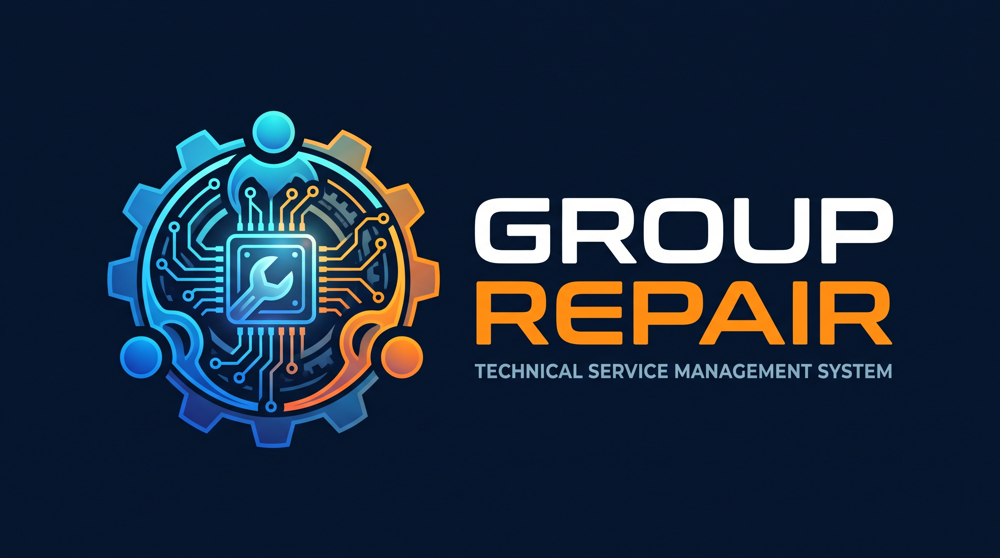

# Group Repair



Plataforma de gestión de servicios técnicos (TSMS) para talleres de reparación de móviles, electrodomésticos y electrónica. Diseñada para administrar de forma trazable la recepción de equipos, el diagnóstico, las reparaciones, presupuestos, repuestos, pagos, entregas y garantías.

> **Estado:** especificación y guía de contribución iniciales. La presencia de estos documentos no implica que la aplicación esté implementada, probada ni desplegada.

## Visión

Group Repair busca reemplazar registros dispersos por un flujo de trabajo profesional: cada equipo y cada decisión quedan vinculados a una orden, con responsable y fecha. No pretende ser un CRUD genérico: incorpora estados controlados, historial auditable y trazabilidad desde la recepción hasta la entrega y la garantía.

## Alcance del producto

- Clientes, equipos e historial técnico.
- Órdenes con estados controlados y cronología auditable.
- Diagnósticos, trabajos, control de calidad y evidencia privada.
- Presupuestos versionados y aceptación registrada.
- Repuestos con movimientos de stock trazables.
- Pagos parciales y ajustes/reembolsos sin borrar el historial.
- Entrega, garantía y reclamaciones vinculadas a la reparación original.
- Panel e informes con autorización por rol y aislamiento de cada taller.

Consulta [`SPEC.md`](SPEC.md) para el alcance funcional y criterios de aceptación, y [`AGENTS.md`](AGENTS.md) para las convenciones de desarrollo y seguridad.

## Estado del proyecto

El repositorio comienza con documentación de producto. La arquitectura, stack, aplicación ejecutable, pruebas, CI y despliegue deberán incorporarse y verificarse antes de considerar el sistema listo para uso real.

## Configuración operativa

- Jurisdicción: San Miguel de Tucumán, Tucumán, Argentina.
- Moneda: pesos argentinos (`ARS`) en unidades menores enteras.
- Horario: lunes a sábado, 9:00 a 21:00 de corrido.
- Domingo: cerrado.
- Consultas de garantía: `+54 9 381 524-9553`.

## Desarrollo

A partir de este estado, el repositorio incluye una aplicación inicial con React, TypeScript, Vite, Cloudflare Workers y Cloudflare D1.

Requisitos:

- Node.js 22 o compatible.
- Cuenta de Cloudflare con acceso a D1 y Workers.
- `npm`.

Comandos:

```powershell
npm install
npm run cf:types
npm run cf:migrate
npm run dev
npm test
npm run typecheck
npm run build
npx wrangler deploy --dry-run
```

La migración local se encuentra en `migrations/0001_initial.sql`. La configuración Cloudflare está en `wrangler.jsonc`. Los importes se representan en unidades menores enteras; no se procesan números reales ni pagos sensibles en esta fase inicial.

## Seguridad y estado operativo

La implementación actual incorpora persistencia, trazabilidad básica, máquina de estados y validaciones del dominio. No debe considerarse lista para datos reales hasta integrar autenticación de usuarios, autorización por taller y rol, protección avanzada y verificaciones operativas completas.

## Seguridad y privacidad

Reporta vulnerabilidades de forma privada al propietario/administrador del repositorio; no publiques datos de clientes, credenciales, tokens ni evidencia privada en issues. No almacenes números completos de tarjeta ni datos personales innecesarios. El repositorio no garantiza cumplimiento legal por sí mismo.

## Despliegue

No existe despliegue configurado todavía. El despliegue futuro debe gestionar secretos fuera del repositorio, aplicar migraciones revisadas, proteger adjuntos, separar entornos y verificar build, migración y pruebas antes de cada publicación.

## Licencia

No se ha definido una licencia. Todos los derechos reservados hasta que el propietario del proyecto añada una licencia explícita.
